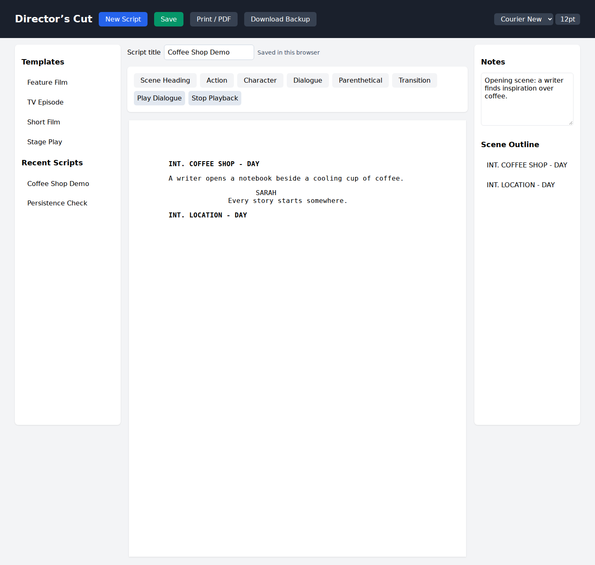

# Director’s Cut — Screenwriting Web Prototype

A browser-based screenplay editor with starter templates, formatting controls, local saving, notes, a scene outline, and browser text-to-speech.



## User workflow
1. Choose Feature Film, TV Episode, Short Film or Stage Play, then edit the screenplay.
2. Apply formatting to the current block or insert a screenplay element.
3. Add notes and a script title. **Save** stores the document in this browser; choose it under Recent Scripts to restore it.
4. **Download Backup** exports the current script and notes as JSON.
5. **Play Dialogue / Stop Playback** controls browser text-to-speech.
6. **Print / PDF** opens the browser print dialog; select Save as PDF where supported. This is browser printing, not a custom PDF-export engine.

[Example printed screenplay](assets/screenplay_demo.pdf) · [Mobile layout](assets/mobile.png) · [Short demo guide](DEMO.md)

## Run locally
```bash
git clone https://github.com/YirenShen-07/DirectorsCut.git
cd DirectorsCut
python -m http.server 8000
```
Open http://localhost:8000/screenwriting.html. Opening screenwriting.html directly also works in many browsers, but local-storage behavior for file URLs varies. No npm installation, API token or backend is required.

## Technical strengths
Vanilla HTML, CSS and JavaScript; editable DOM blocks, event handling, document state, unsaved-change prompts, localStorage persistence, safe text rendering, object-URL JSON downloads, print CSS and the browser Speech Synthesis API.

The former Tailwind CDN import was present in the source but is now removed; styling is self-contained. Unused character-profile code and placeholder scenes are removed. Scene navigation is generated from actual scene headings. There is no generative AI or character-specific voice model.

## Verification and limits
Save/reload, note persistence, JSON backup, templates, scene outline, print invocation and responsive layout are exercised by the maintenance verification. Automated speech checks verify API integration; audible playback depends on the browser and available voices.

Saving is local to the browser and origin. Clearing browser storage removes saved scripts; the JSON download is a backup export, and importing it is not yet implemented. There is no cloud sync or collaboration service.

## Attribution and license
Original Duke hackathon project in Yiren Shen's portfolio. Individual team contributions have not been independently established and are not invented here. The 2026 maintenance pass adds working persistence and printing with AI assistance. No MIT or other license grant is claimed; a project license requires confirmation of ownership and team agreement.
